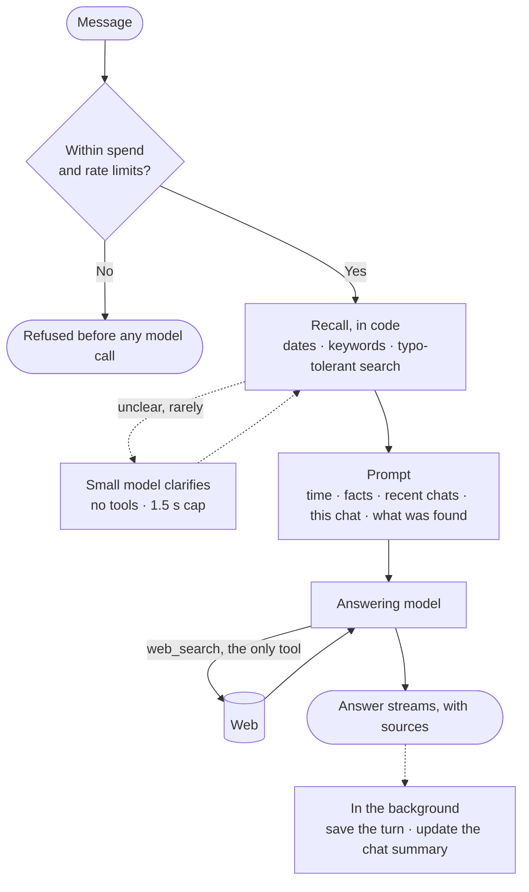

# Mino

> **Search is the easy half. Time is the hard half.**

"Has any pricing changed since last Tuesday?" asks an agent to know what it said, when it said it, and whether that still holds today. Mino keeps every conversation as a dated record, finds the right one, and checks it again on the web.

## How it works

The model only calls `web_search`. Memory is code that runs before it, so the past is already in the prompt.

| What the model sees | When |
| --- | --- |
| Time and time zone | Always |
| Facts the user stated | Always |
| Summaries of the 15 most recent chats | Always |
| This chat: recent turns, older ones summarized | Always |
| Exact past turns, with sources and dates | When the message names a date or asks what changed |

The first four layers follow [ChatGPT's memory, as reverse-engineered in public](https://llmrefs.com/blog/reverse-engineering-chatgpt-memory). The clarifying step follows [Vane](https://github.com/ItzCrazyKns/Vane/blob/master/docs/architecture/WORKING.md), an open-source answer engine. The last layer is Mino's own: a summary says pricing came up, but only the record shows the price and the date.

| The user asks | A matching chat exists | Nothing matches |
| --- | --- | --- |
| "Last Tuesday I asked you about Postgres hosting. Has any pricing changed since then?" *(from the brief)* | Loads Tuesday's answer, searches each provider, and gives the old price, today's price and both dates | Says there is no record for Tuesday, then gives current pricing |
| "What did I ask you yesterday about my Goa trip?" | Quotes the question and answer, with the time | Says nothing was logged that day, and invents nothing |
| "Which laptop did you suggest last week? Is it still the best pick?" | Finds last week's pick, searches for its price and newer models, and says what changed | Says there is no record, then gives a current pick |

## Decisions

| Decision | Why | Cost |
| --- | --- | --- |
| **Recall runs in code, not as a tool** | The brief allows one tool. Every date question is checked, with no extra round trip. Provider-side state differs per provider and keeps a transcript, not a dated search across chats | The model cannot look further mid-answer |
| **One finding per message** | The model is told in one sentence: found that day, found on another day, found by topic, or nothing | Each new case needs a named finding |
| **Exact log, plus summaries** | Summaries keep prompts small. The log stays the source of truth for exact words and prices | A summary lags one reply behind |
| **Code first, small model only when unclear** | Dates and typos resolve in milliseconds. The small model runs only for vague or unmatched references, and the reply goes on if it fails | Rare phrasings depend on it |
| **No vector database** | These lookups are dates and names. A trigram index plus edit distance handles typos with no extra service | The same idea in other words can be missed |
| **Bounded, cache-friendly prompt** | History is capped at 30,000 characters and recall at 16,000. Stable parts come first, so providers reuse the cached prefix | Very old turns of a long chat are only summarized |
| **The server owns each reply** | Numbered events let any tab resume after a refresh or dropped network. Drafts save every 400 ms | One process holds live replies |
| **Hard spending limits** | Every reply has output, search and time caps. A daily budget refuses messages before any model call | Long research can hit a cap |
| **One event stream for three engines** | Gemini, Claude and OpenAI map to the same events, and shared tests check they match | Gemini cannot cap its own searches |

Web results and old chats are escaped and marked as data, so instructions inside them are ignored.

## Code layout

| Layer | Holds |
| --- | --- |
| `http` | Routes only: parse the request, call a service |
| `services` | The reply flow, settings, spending limits |
| `context` | Builds the prompt, writes chat summaries and titles |
| `memory` | Recall, ranking, fact rules, prompt rendering |
| `llm` | One adapter per provider, plus the small model |
| `db/repositories` | Turns, threads, summaries, facts, usage |

Each layer imports only the layers below it, so swapping SQLite for Postgres touches only `db`.

## How it scales

Everything lives in one SQLite file, so `npm install` and `npm run dev` are enough. On a laptop, a date lookup takes 1 ms at 100,000 chats, and typo-tolerant search takes 80–140 ms. Prompt size does not grow with history. More users would need a user ID on each row, Postgres, and a shared store for live replies. Recall would not change.

## What I rejected

| Option | Why not |
| --- | --- |
| A history tool | The brief says one tool. If that reading is wrong, I would add it so the model can look further mid-answer |
| Provider-side memory | OpenAI can store conversations and Claude has a memory tool, but each works differently, and Claude's is a second tool |
| Sending all history | Slow and costly on every message |
| My own search pipeline | Hosted search already returns results with citations |
| Next.js | A chat needs one page and one streaming endpoint |

## With another week

1. Measure speed and accuracy on real models. I have not yet.
2. Make web search stateful, so a follow-up continues earlier searches instead of starting over.
3. Snapshot official pricing pages, so "unchanged" can be proven.
4. Store prices as dated facts for exact comparison.
5. Add embeddings for the same idea in different words.
6. Add a profile in Settings, like ChatGPT's custom instructions, with a list of saved facts the user can delete.
