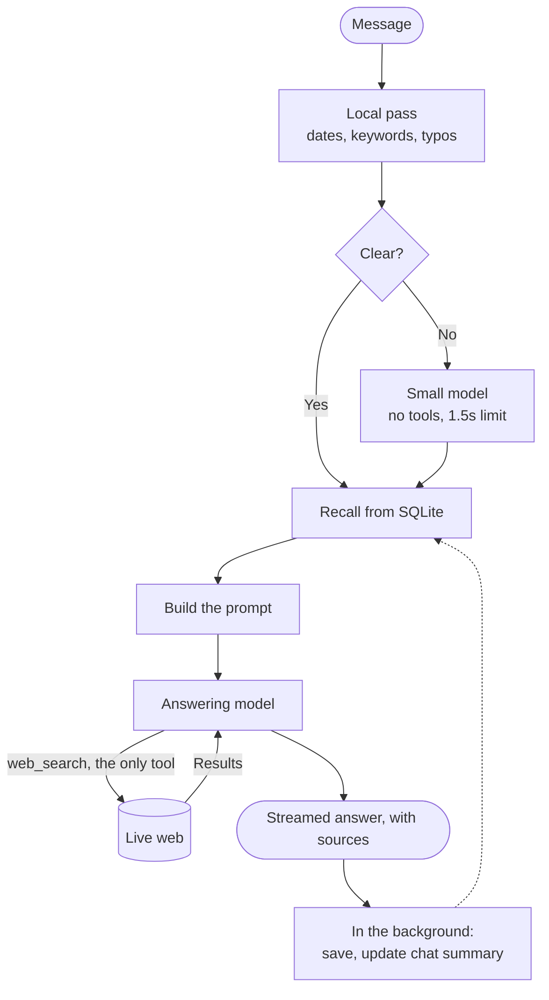

# Mino

> **Search is the easy half. Time is the hard half.**

"Has any pricing changed since last Tuesday?" asks an agent to know what it said, know when it said it, and check that against today. Mino treats every conversation as a dated record it can find and re-verify, with one tool.

## How it works

The model only ever calls `web_search`. Memory is ordinary code that runs first, so the past is already on the page when the model starts reading.

**What the model sees**

| Layer | Sent |
| --- | --- |
| Time and time zone | Always |
| Facts the user stated | Always |
| Summaries of 15 recent chats | Always |
| This chat: recent turns, older ones summarized | Always |
| Exact past turns, with sources and dates | For a date, or "what changed" |

The always-on layers follow [ChatGPT's reported design](https://llmrefs.com/blog/reverse-engineering-chatgpt-memory). The step that clarifies a message before answering follows [Vane](https://github.com/ItzCrazyKns/Vane/blob/master/docs/architecture/WORKING.md), an open-source answer engine. The last layer is Mino's own, because a summary cannot quote what you asked on 3 November.

**The brief's examples**

| Question | Mino finds the chat | Mino finds nothing |
| --- | --- | --- |
| "On Monday we shortlisted 5 CRM tools..." | Searches each product, shows then and now | Says so, checks recent CRM news, asks which five |
| "What did I ask you on 3 November?" | Quotes it, re-checks what can change | Says so, invents nothing |
| "Last Tuesday I asked about Postgres hosting..." | Searches each provider, gives both dates | Says so, searches current pricing anyway |

## Why this design

- **Remembering is not optional.** The brief gives the agent one tool, so recall runs in code. A date question never depends on the model deciding to look.
- **Every message has exactly one finding:** on that date, on another date, by topic, or no record. The model is told which, in one sentence, rather than left to infer it.
- **Summaries for breadth, exact words for truth.** Summaries keep prompts small. The log remains the source of truth for what was said and what it cost then.
- **Honest about change.** Unless a source shows a value on both dates, the model is told to say "no evidence of change", never "unchanged".
- **Built for how people type.** Misspelled dates and common Hinglish resolve locally, in milliseconds. A small model steps in only when a message is unclear, and the reply continues if it fails.
- **A reply belongs to the server, not the tab.** Refresh, switch tabs or lose the network, and the answer resumes without repeating a word.
- **Spending has hard edges.** Every reply has output and search caps and a timeout. A daily budget stops requests before any model is called.

## How it scales

Recall is local, and the prompt stays near 15,000 tokens however long the history grows.

| Chats stored | Date lookup | Typo-tolerant search |
| --- | --- | --- |
| 1,000 | 1ms | 2ms |
| 10,000 | 1ms | 8ms |
| 100,000 | 1ms | 80–140ms |

Mino is one user on one process, by design. More users would need a user ID on each row, Postgres, and a shared stream store. Recall and prompt building would not change.

## What I rejected

| Option | Why not |
| --- | --- |
| A history tool | The brief says one tool. It would let the model look further mid-answer, and I'd add it if that reading is wrong |
| Vector database | These lookups are dates and names |
| Sending all history | Slow and costly on every message |
| Own search pipeline | Hosted search already gives results and citations |
| Next.js | A chat needs one page and one streaming endpoint |

## With another week

1. Measure speed and accuracy on real models. I have not yet.
2. Snapshot official pricing pages, so "unchanged" can be proven.
3. Store prices as dated facts for exact comparison.
4. Add embeddings for the same idea in different words.
