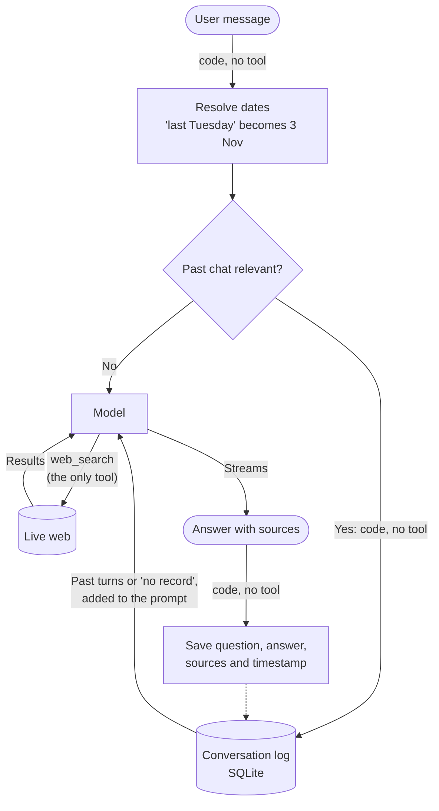

# Mino: design

**Searching the web is the easy half of this challenge. The hard half is time.** Questions like "Has any pricing changed since last Tuesday?" need the agent to know what it said on a given date, and then check that against today. So Mino treats every conversation as a dated record it can look up and re-verify.

## How it works

The model's tool list has exactly one entry: `web_search`. Every arrow marked "code" runs on the server around the model call, and its result reaches the model as text in the prompt.

Here is what happens on questions from the brief:

| Question | What Mino does |
| --- | --- |
| "What did I ask you on 3 November?" | Code turns the date into a day window in the user's time zone and reads that day's turns. If there are none, it says so instead of guessing. |
| "Last Tuesday I asked you about Postgres hosting. Has any pricing changed since then?" | Finds that turn with its old prices and sources, searches each provider again, and reports what changed, with both dates. |
| "On Monday we shortlisted 5 CRM tools. Has any of them changed pricing or shipped something big since?" | Same flow, item by item. Anything it cannot confirm is reported as unverified, never as unchanged. |

## Why I built it this way

- **Memory runs in code, not as a tool.** The brief allows one tool, so recall happens before the model is called. A date question then never depends on the model deciding to look. [ChatGPT reportedly works the same way](https://llmrefs.com/blog/reverse-engineering-chatgpt-memory), injecting memory into each prompt.
- **Recall survives how people really type.** Misspelled dates and topics, and Hinglish like "pichhle mangal", still resolve. Local search runs on every message, and only strong matches reach the prompt.
- **Context has a hard budget.** The newest turns are kept first, within a fixed size, and older ones stay reachable through search.
- **Stated facts are always known.** "My name is..." or "I am vegetarian" are saved by plain code, and a newer statement replaces an older one.
- **Turns are stored word for word.** "What did I ask?" needs the exact words, and "has it changed?" needs the old numbers and sources. A summary can lose either for good.
- **"No record" is a fact the model is given.** This stops it from inventing a past conversation. If the user gets a date wrong, Mino still finds the topic and gives the real date.
- **Speed comes from doing less.** Ordinary questions skip memory completely, recall is a local query, text streams as it is generated, and the UI shows each search.
- **A reply belongs to the server, not the tab.** Switching tabs, refreshing or going back only stops watching. The reply keeps running and saves as it streams, numbered events let any tab resume without repeats, and Stop keeps what already arrived.
- **Spend has hard limits.** Each reply has output and search caps and a timeout, and a daily dollar budget and message limits refuse new requests before any model is called.
- **Retrieved text is treated as data.** Web results and old turns can contain instructions, so they are marked as data and stored text is escaped.
- **Any provider's key works.** Gemini, Claude and OpenAI each map their stream onto the same events. Keys come from `.env` or the in-app Settings, are verified with a free model-list call, and never leave the server. Gemini Flash is the default for speed, and Zod validates settings and requests.

## What I considered and rejected

| Option | Why not |
| --- | --- |
| Temporal knowledge graph ([Graphiti](https://github.com/getzep/graphiti)) | I kept its core idea, that facts have dates. A graph database and LLM extraction on every write are too heavy for one user's chats, and extraction can get the record wrong. |
| LLM-extracted memories ([Mem0](https://github.com/mem0ai/mem0)) | An extra model call on every message, and it keeps a summary rather than the exact words these questions need. Explicit facts are caught by simple rules instead. |
| A `search_memory` tool | Adds a round trip, and the model can skip it. |
| Vector search over history | These lookups are dates and product names, where date filters and keywords are exact. |
| Own search and scrape pipeline ([Vane](https://github.com/ItzCrazyKns/Vane)) | More control, but much more to run. Hosted search gives results and citations through one key. |
| Next.js | A chat UI needs one page and one streaming endpoint. |

## What I'd do with another week

1. Run an eval on the question set and tune model and search count on measured speed and accuracy. I have not measured either yet.
2. Keep real snapshots of official pricing pages, so "unchanged" can be proven rather than only "no evidence of change".
3. Store prices as dated structured facts next to the raw turns, for exact diffs, and catch facts stated indirectly with a background model call.
4. Add accounts, since memory is one local user today.
5. Add embeddings for recall when the same idea is phrased in completely different words.
