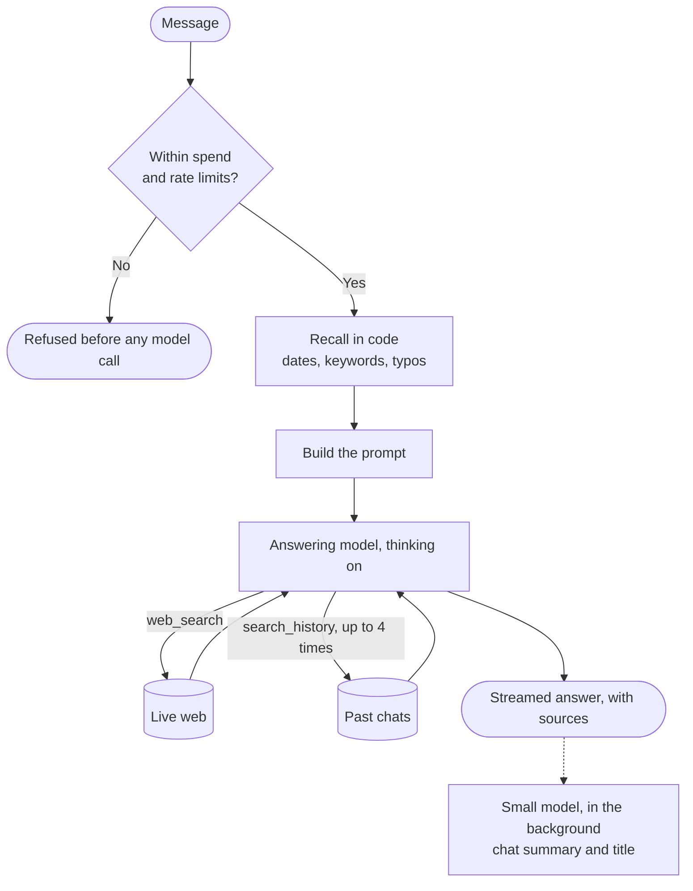

# Mino

> **Search is the easy half. Time is the hard half.**

"Has any pricing changed since last Tuesday?" asks an agent to know what it said, know when it said it, and check that against today. Mino treats every conversation as a dated record it can find and re-verify.

## How it works

Recall runs twice. Code finds the obvious match before the model starts, so most answers need no lookup. When that is not enough, the model searches the history itself, by date or topic, as many as four times.

**What the model sees**

| Layer | Sent |
| --- | --- |
| Time and time zone | Always |
| Facts the user stated | Always |
| Summaries of 15 recent chats | Always |
| This chat: recent turns, older ones summarized | Always |
| Exact past turns, with sources and dates | For a date, or "what changed" |
| Anything else in the history | When the model asks for it |

The always-on layers follow [ChatGPT's reported design](https://llmrefs.com/blog/reverse-engineering-chatgpt-memory), and summarizing older turns follows [LobeHub](https://github.com/lobehub/lobe-chat). Exact, dated recall is Mino's own, because a summary cannot quote what you asked on 3 November.

**The brief's examples**

| Question | Mino finds the chat | Mino finds nothing |
| --- | --- | --- |
| "On Monday we shortlisted 5 CRM tools..." | Searches each product, shows then and now | Says so, checks recent CRM news, asks which five |
| "What did I ask you on 3 November?" | Quotes it, re-checks what can change | Says so, invents nothing |
| "Last Tuesday I asked about Postgres hosting..." | Searches each provider, gives both dates | Says so, searches current pricing anyway |

## Why this design

- **Code first, model second.** A clear date question never waits on the model deciding to look. A vague one gets the model's own search, with thinking to plan it.
- **Every message has exactly one finding:** on that date, on another date, by topic, or no record. The model is told which, in one sentence.
- **A strong match or nothing.** A chat from another day is offered only when its topic clearly matches, never on one shared word like "pricing".
- **Summaries for breadth, exact words for truth.** Summaries keep prompts small. The log remains the source of truth for what was said and what it cost then.
- **Honest about change.** Unless a source shows a value on both dates, Mino says "no evidence of change", never "unchanged".
- **Big model answers, small model writes.** Gemini 3.8 Flash, Claude Sonnet 5.5 or GPT-6.1 Terra does the thinking, searching and answering. Flash-Lite, Haiku or GPT-6 Luna only writes summaries and titles, after the reply.
- **A reply belongs to the server, not the tab.** Refresh, switch tabs or lose the network, and the answer resumes without repeating a word.
- **Spending has hard edges.** Every reply has output, web search, history lookup and time caps. A daily budget stops requests before any model is called.

The code is layered: `http` → `services` → `context` → `memory` · `llm` → `db/repositories`. Each layer imports only those below it. 160 tests cover recall, the tool loop on all three engines, streaming and spending.

## How it scales

Recall is local, and the prompt is capped however long the history grows.

| Chats stored | Date lookup | Typo-tolerant search |
| --- | --- | --- |
| 1,000 | 1ms | 2ms |
| 10,000 | 1ms | 8ms |
| 100,000 | 1ms | 80–140ms |

Mino is one user on one process, by design. More users would need a user ID on each row, Postgres, and a shared stream store. Recall and prompt building would not change.

## What I rejected

| Option | Why not |
| --- | --- |
| History only as a tool | Every date question would cost a round trip and depend on the model choosing to look |
| Vector database | These lookups are dates and names |
| Sending all history | Slow and costly on every message |
| Own search pipeline | Hosted search already gives results and citations |
| Vercel AI SDK | Each provider's search and citations differ, and I wanted to map and test them directly |
| Next.js | A chat needs one page and one streaming endpoint |

## With another week

1. Measure speed and accuracy on real models. I have not yet.
2. Make web search stateful, so a follow-up continues earlier searches.
3. Snapshot pricing pages, so "unchanged" can be proven.
4. Add embeddings for the same idea in different words.
5. Add a Settings profile, like ChatGPT's custom instructions, with editable saved facts.
