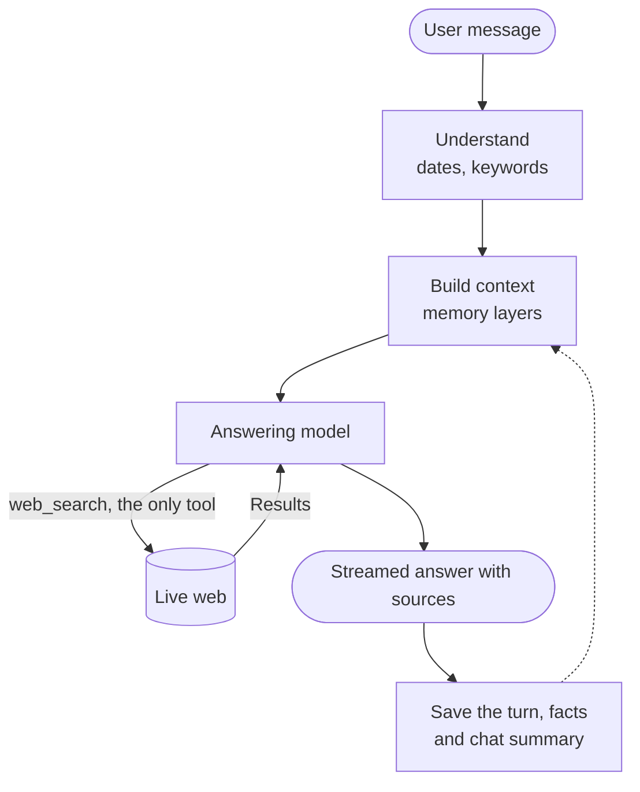

# Mino: design

**Searching the web is the easy half of this challenge. The hard half is time.** "Has any pricing changed since last Tuesday?" needs the agent to know what it said on a given date, then check that against today, with only one tool.

## How it works

The model only ever calls `web_search`. Memory is ordinary code that runs before the model, so nothing has to be fetched mid-answer. The design reuses two reported patterns: [ChatGPT's memory layers](https://llmrefs.com/blog/reverse-engineering-chatgpt-memory) and [Perplexity's search loop](https://www.langchain.com/breakoutagents/perplexity).

| Memory layer | When it is sent |
| --- | --- |
| Time and time zone | Every message |
| User facts: name, diet, preferences | Every message |
| Summaries of about 15 recent chats | Every message |
| This chat: recent turns, older ones as a summary | Every message |
| Exact past turns, sources and dates | Only for a date or "what changed" |

For the brief's examples:

| Question | With a past chat | With no record |
| --- | --- | --- |
| "On Monday we shortlisted 5 CRM tools..." | Loads Monday's chat, searches each product, shows old vs new | Says so, searches recent CRM changes, asks which five |
| "What did I ask you on 3 November?" | Quotes it, re-checks what can change | Says nothing is on record, invents nothing |
| "Last Tuesday I asked about Postgres hosting..." | Loads that chat, searches each provider, gives both dates | Says so, still searches current pricing |

## Why I built it this way

- **Memory runs in code, not as a tool.** The brief allows one tool, and a date question should never depend on the model choosing to look.
- **Exact turns and summaries, not one or the other.** Summaries keep every prompt small. "What did I ask?" and "has it changed?" need the exact words and old prices, so the log stays the source of truth.
- **"No record" is a fact the model is given.** It cannot invent a past chat, and it still helps with the topic.
- **Recall handles how people type.** Misspelled dates and topics and common Hinglish still resolve locally in milliseconds. A small model with no tools handles only unclear messages, and the reply continues if it fails.
- **A reply belongs to the server, not the tab.** Refreshing or switching tabs only stops watching. Numbered events let any tab resume without repeats.
- **Spend has hard limits.** Each reply has output and search caps and a timeout, and a daily budget refuses requests before a model is called.
- **Retrieved text is treated as data,** so instructions inside web pages or old chats are ignored and stored text is escaped.
- **Any provider's key works,** with a small, fast model by default.

## What I considered and rejected

| Option | Why not |
| --- | --- |
| Vector database | These lookups are dates and names, and ChatGPT reportedly works without one |
| A memory tool | The brief allows one tool, and the model could skip it |
| Sending all history | Slow and costly on every message |
| Own search and scrape pipeline | Hosted search already gives results and citations |
| LLM fact extraction on every message | An extra call per message. Simple rules catch stated facts |
| Next.js | A chat UI needs one page and one streaming endpoint |

## What I'd do with another week

1. Run an eval on real models and tune on measured speed and accuracy. I have not measured either yet.
2. Keep snapshots of official pricing pages, so "unchanged" can be proven.
3. Store prices as dated structured facts for exact diffs.
4. Add embeddings for the same idea phrased in different words.
5. Add accounts, since memory is one local user today.
