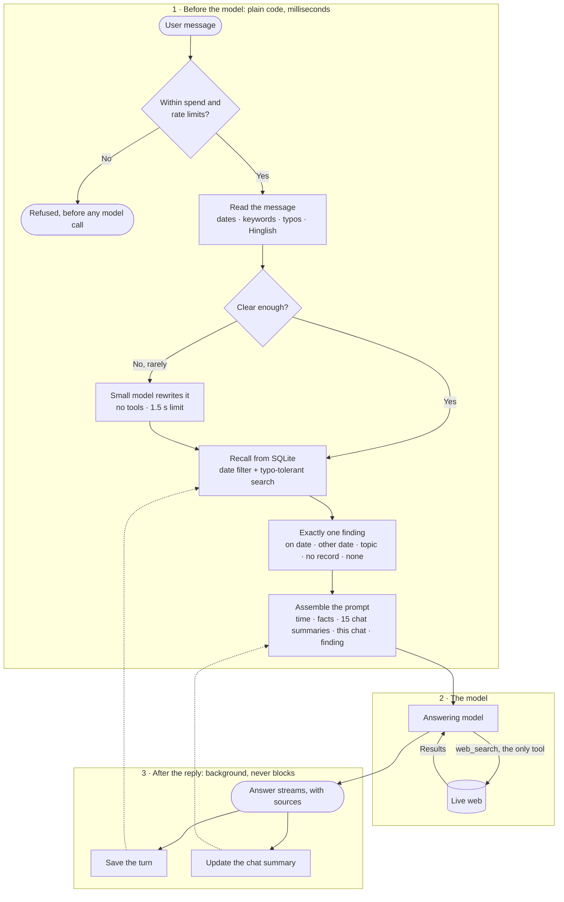

# Mino

> **Search is the easy half. Time is the hard half.**

"Has any pricing changed since last Friday?" asks an agent to know what it said, know when it said it, and check that against today. Mino treats every conversation as a dated record it can find and re-verify, with one tool.

## How it works

The model only ever calls `web_search`. Memory is ordinary code that runs first, so the past is already in the prompt when the model starts.

| What the model sees | When |
| --- | --- |
| Time and time zone | Always |
| Facts the user stated | Always |
| Summaries of the 15 most recent chats | Always |
| This chat: recent turns, older ones summarized | Always |
| Exact past turns, with sources and dates | For a date, or "what changed" |

Two of these patterns are borrowed. The always-on layers follow [ChatGPT's memory, as described in public reverse-engineering](https://llmrefs.com/blog/reverse-engineering-chatgpt-memory), and the clarifying step follows [Vane](https://github.com/ItzCrazyKns/Vane/blob/master/docs/architecture/WORKING.md), an open-source answer engine. The exact-turn layer is Mino's own: a summary can say that pricing came up, but only the original record shows what was said, and on which date.

**How Mino handles a reference to the past**

| The user asks | A matching chat exists | Nothing matches |
| --- | --- | --- |
| "Last Tuesday I asked you about Postgres hosting. Has any pricing changed since then?" *(from the brief)* | Loads Tuesday's answer, searches each provider, and reports the earlier price, today's price and both dates | States there is no record for Tuesday, then reports current pricing anyway |
| "What did I ask you yesterday about my Goa trip?" | Quotes the question and answer, with the time they were said | States that nothing was logged that day, and invents nothing |
| "kal jo laptop wali baat hui thi, uska budget kya tha?" | Reads "kal" as yesterday and answers from that chat, in Hinglish | Says there is no record, and asks for the budget |

## Architecture decisions

| Decision | Why | What it costs |
| --- | --- | --- |
| **Recall runs in code, not as a tool** | The brief allows one tool. A date question never depends on the model choosing to look, and no extra round trip is spent | The model cannot fetch more history mid-answer |
| **Exactly one finding per message** | The model is told in one sentence whether the chat was found that day, on another day, by topic, or not at all, so it never has to infer it from scattered signals | Each new case needs a named finding |
| **Exact log, plus summaries** | Summaries keep every prompt small. The log stays the source of truth for exact words and old prices | Two kinds of memory to maintain |
| **Local pass first, small model only when unclear** | Dates, typos and common Hinglish resolve in milliseconds at no cost. The small model has a 1.5 s limit and the reply continues if it fails | Rare phrasings rely on the small model |
| **No vector database** | These lookups are dates and names. A trigram index and edit distance handle typos with no extra service or API call | The same idea in entirely different words can be missed |
| **Bounded prompt** | History is capped at 30,000 characters and recalled chats at 16,000, newest first, so the prompt stays near 15,000 tokens however long the history grows | Very old turns of a long chat are only summarized |
| **Cache-friendly order** | The stable system prompt and history come first, and everything that changes comes last, so providers can reuse the cached prefix | None |
| **Background work after the reply** | Saving, summaries and their retries never delay an answer | A summary appears one reply late |
| **A reply belongs to the server** | Numbered events let any tab resume after a refresh or a dropped network without repeating a word. Drafts are saved every 400 ms, and a crash leaves the reply marked as stopped | One server process holds active replies |
| **Spending has hard edges** | Output, search and time caps on every reply, and a daily budget that refuses requests before any model call | A long research answer can hit a cap |
| **One event stream for every engine** | Gemini, Claude and OpenAI are mapped to the same events, and shared tests check they behave identically | Gemini cannot cap its own searches |
| **Retrieved text is data** | Web results and old chats are marked as data and escaped, so instructions inside them are ignored | None |
| **SQLite in a single file** | Nothing extra to install, and `npm install` then `npm run dev` just works | One user on one machine |

## How it scales

| Chats stored | Date lookup | Typo-tolerant search |
| --- | --- | --- |
| 1,000 | 1ms | 2ms |
| 10,000 | 1ms | 8ms |
| 100,000 | 1ms | 80–140ms |

Measured on a laptop. Prompt size does not grow with history. More users would need a user ID on each row, Postgres, and a shared stream store. Recall and prompt building would not change.

## What I rejected

| Option | Why not |
| --- | --- |
| A history tool | The brief says one tool. I'd add it if that reading is wrong, so the model could look further mid-answer |
| Sending all history | Slow and costly on every message |
| Own search pipeline | Hosted search already returns results with citations |
| Next.js | A chat needs one page and one streaming endpoint |

## With another week

1. Measure speed and accuracy on real models. I have not yet.
2. Snapshot official pricing pages, so "unchanged" can be proven.
3. Store prices as dated facts for exact comparison.
4. Add embeddings for the same idea in different words.
